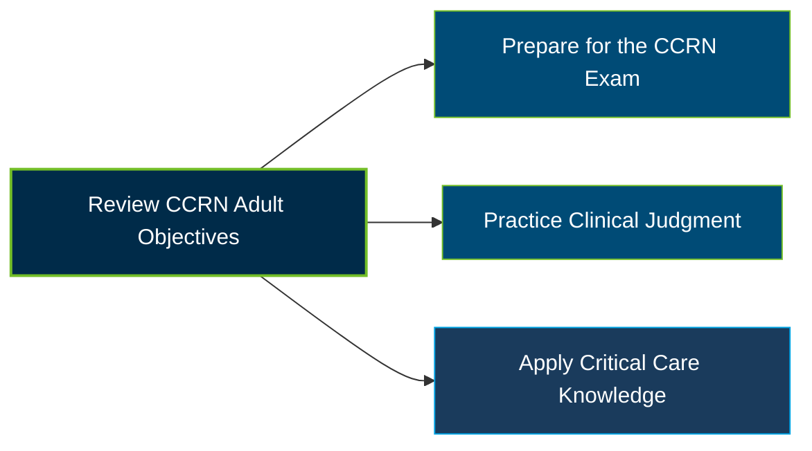

# AACN CCRN Adult Certification Exam Guide

A dedicated study guide and clinical knowledge reference for nurses preparing for the **AACN CCRN (Adult) Certification Exam**, with a focus on acute and critical care nursing, clinical judgment, and professional practice.

---

## Exam Overview

The AACN CCRN (Adult) certification validates specialized knowledge for nurses caring for acutely and critically ill adult patients. The exam follows the AACN Synergy Model for Patient Care and covers clinical judgment alongside professional caring and ethical practice.

- **Exam Format**: Multiple-choice examination
- **Target Audience**: Registered nurses and advanced practice registered nurses pursuing adult acute/critical care specialty certification
- **Prerequisites**: A current, unencumbered U.S. RN or APRN license and qualifying clinical practice hours under an AACN eligibility pathway

---

## Core Exam Domains & Knowledge Areas

### 1. Cardiovascular

- Acute coronary syndrome, heart failure, cardiomyopathy, and cardiac surgery.
- Dysrhythmias, hemodynamic instability, cardiogenic shock, and cardiac tamponade.
- Vascular disorders, cardiac catheterization, and cardiovascular interventions.

### 2. Respiratory

- Acute respiratory failure, acute respiratory distress syndrome (ARDS), and pulmonary embolism.
- Mechanical ventilation, airway management, oxygen therapy, and related complications.
- Pneumothorax, pleural disorders, pulmonary hypertension, and thoracic trauma.

### 3. Endocrine, Hematology/Immunology, Gastrointestinal, Renal/GU, and Integumentary

- Diabetes, diabetic ketoacidosis, endocrine disorders, and fluid or electrolyte imbalances.
- Anemia, coagulopathies, transfusion reactions, and immune-related conditions.
- Gastrointestinal emergencies, liver disease, acute kidney injury, and integumentary problems.

### 4. Neurological and Multisystem Clinical Conditions

- Neurological emergencies, seizures, stroke-related concerns, and neurosurgical conditions.
- Sepsis, shock states, systemic inflammatory response syndrome, and multiple organ dysfunction.
- Trauma, pain, thermoregulation, toxic exposure, and other complex critical care conditions.

### 5. Professional Caring and Ethical Practice

- Advocacy, moral agency, and patient- and family-centered care.
- Collaboration, communication, and facilitation of learning.
- Clinical inquiry, evidence-based practice, response to diversity, and systems thinking.

---

## Certification Path

The following is a suggested study and professional development progression, not an official AACN certification pathway.

---

## Recommended Practice & Study Resources

Combine official AACN materials, structured practice, and clinical application to prepare for the CCRN Adult certification exam.

- **CertsGate**: Explore [CCRN Adult certification preparation resources](https://certsgate.com/exams/aacn/ccrn-adult) for supplementary study materials and practice questions to help identify knowledge gaps.
- **Clinical Practice and Evidence-Based Resources**: Reinforce critical care concepts using the [AACN](https://www.aacn.org/) clinical resources, current evidence-based nursing guidance, and case-based practice focused on assessment, prioritization, interventions, and patient safety.
